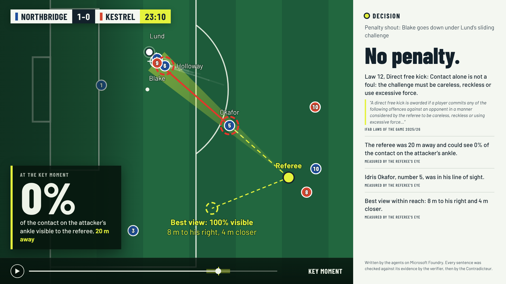
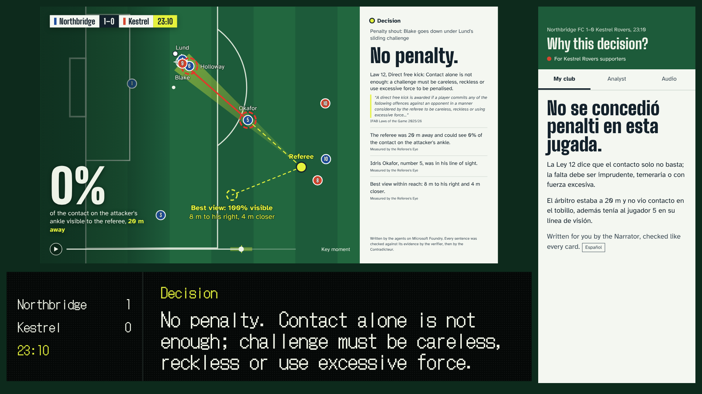

# The Fourth Official

[](https://github.com/Delmas2005/MicrosoftHackthon/actions/workflows/tests.yml)

**VAR sees everything. The stadium understands nothing. We show what the referee could actually see.**

74% of Premier League fans say the reasoning behind VAR decisions is not clear (Football Supporters'
Association survey of almost 8,000 fans, reported by BBC Sport, March 2026). Every camera shows what
VAR saw; none shows what the referee could see from where he stood.

The Fourth Official measures it from tracking data, live, and explains each decision with the Law in
hand, on three screens:

- **TV panel**, during the VAR check: the referee's line of sight, who hid the incident and by how
  much, the clause of the Laws, and where he could have seen it from.
- **Stadium board**, once the officials have decided: one short line.
- **"Why?" on the phone**: for the supporters of the club that lost the call, in their language,
  with an analyst view and an audio version read aloud.

**Try it:** https://fourthofficialweb.z28.web.core.windows.net/?screen=wall (the three screens together; `?screen=tv`, `?screen=stadium`, `?screen=phone` for each one)
**Video (1 min 44 s):** https://youtu.be/pZxwp7BIxSU

Built for the Microsoft × Premier League *Inside the Game* hackathon by two students, on an
**Azure for Students** account: no credit card, free tiers wherever one exists, and
**€1.70 of student credit for the whole hackathon**. Every club, player, official and venue in
this repository is fictional. All match data is synthetic.



## Built on a student budget

We wanted to show that this needs no budget: anyone with a student account can rebuild it, end to
end, without paying.

| Service | What it does here | Tier | Cost |
|---|---|---|---|
| Microsoft Foundry: gpt-5-mini, gpt-4.1-mini | the agents | Global Standard, pay per token | €1.70 |
| Azure AI Search | the Laws of the Game index | Free | 0 |
| Azure Web PubSub | live cards to the screens | Free | 0 |
| Azure AI Speech | neural voice for the audio cards and the video | Free (F0) | 0 |
| Application Insights | a trace of every agent and model call | free monthly allowance | 0 |
| Azure Storage, static website | the three screens, online | Standard LRS | under €0.01 |
| GitHub Actions | the tests, on every push | free for public repos | 0 |
| **Total for the hackathon** | | | **€1.70** |

From Azure Cost Management, resource group `rg-fourth-official`, 22 to 27 October 2026. Almost all of it
is model calls, and most of it was spent on 26 October, the day of the held-out benchmark, the
latency runs and the evaluation. What the student
account changed: Azure Static Web Apps was refused in every region on our subscription, so the
screens run as a static website on Azure Storage instead, for a few cents. The two models were
chosen for what they cost per call as much as for what they do: the strong one only where reasoning
is needed (Laws Clerk, Contradicteur, RefBench), the fast one for writing (Narrator) and for the
evaluation.

## Three rules, enforced in code

1. **Never ahead of the officials.** A decision only appears once the officials have settled it.
2. **Every sentence on screen cites evidence**: a measurement, an event in the feed, a Law, a player.
3. **Every number on screen matches that evidence.**

`agents/card.py` checks every card before it is shown, without any model. Then an AI agent, the
Contradicteur, checks what a program cannot: whether each sentence *means* what its evidence says.

## How a card is made

```
match feed ─► Spotter ─► template card (revision 1, instant) ─► verifier ─► screens
                              │
                              └─► Laws Clerk ─► Contradicteur ─► verifier ─► screens   (revision 2)
                                                     │
                                                     └─► Narrator ─► verifier ─► Contradicteur ─► screens   (revision 3)
```

| Agent | Model on Microsoft Foundry | Job | What stops it from being wrong |
|---|---|---|---|
| Laws Clerk (`agents/laws_clerk.py`) | gpt-5-mini | Searches the IFAB Laws of the Game 2025/26 in Azure AI Search (its own queries, up to 4) and cites the clause that applies | The quote must appear word for word on a page it actually read, from a Law that applies; the explanation must be general, short, with no invented number and no player name. One chance to fix, then the template sentence. |
| Contradicteur (`agents/contradicteur.py`) | gpt-5-mini | Reviews every sentence with its true evidence: keeps or drops it (says more than its evidence, blames the officials, hints at a decision not yet made, cites a Law for another situation, partisan). Can flag a "referee's call". | It can only remove sentences, never add or rewrite one. A sentence it does not rule on is dropped. If it fails, the verifier's result stands. |
| Narrator (`agents/narrator.py`) | gpt-4.1-mini | Rewrites the reviewed TV card for the stadium, the fan (club, language) and audio | Every sentence names the sentences it comes from and inherits their evidence; numbers must be digits; the result goes through the verifier and the Contradicteur again, and is shown whole or not at all. |

The **template narrator** (`agents/fallback_narrator.py`) builds a correct card from the measurements
alone. It is published at once, and stays on screen if a model is slow, fails, or every sentence is
rejected: the match never waits for AI.

The demo: `py -m agents.contradicteur --all --traps` plants a sentence in every card with the right
number and the wrong conclusion ("the referee could see 0% of it, so the decision was a guess"). The
verifier cannot catch it; the Contradicteur caught 5 out of 5.

## RefBench

gpt-5-mini as a VAR assistant, on two sets of 100 incidents (20 of each kind). We wrote the prompt
on the first set ("tuning"); the second ("held out") was never looked at until the final run, so it
is the honest score. 95% confidence intervals in brackets: with 100 incidents, a few points either
way is noise.

| | Set | Right decision | Clear errors flagged for VAR | VAR calls that were justified | Steps in on borderline calls | Final decision right |
|---|---|---|---|---|---|---|
| Trusting the call on the field | tuning | 82% [73–88] | 0% | n/a | 0% | 89% |
| Fourth Official agents | tuning | 82% [73–88] | 100% | 38% | 57% | 82% |
| Trusting the call on the field | held out | 70% [60–78] | 0% | n/a | 0% | 82% |
| **Fourth Official agents** | **held out** | **90% [83–95]** | 89% (16 of 18) | 64% (16 of 25) | 33% (4 of 12) | 89% |

Over both sets (200 incidents): agents 86% [80–90], call on the field 76% [70–81]. On the same
incidents, the agents were right where the field was wrong 42 times, and the reverse 22 times
(exact McNemar test, p = 0.017). The held-out set happens to be harder for the call on the field
(70% against 82%), which is why both sets are shown.

By kind of incident, held-out set (agents vs the call on the field): offside 100% vs 65%, denying a
goal-scoring opportunity 100% vs 80%, penalty contact 95% vs 55%, handball 90% vs 80%, holding 65% vs 70%.

What it tells us: on incidents it had never seen, the agents reached the right decision more often
than the call on the field (90% against 70%) and flagged 16 of the 18 clear errors. But 9 of their
25 VAR calls were not justified, they stepped in on 4 of 12 borderline calls that VAR should leave
to the referee, and holding is still their weak spot. Across both sets, following them would not
change how many final decisions are right (85.5% either way). They read the Laws well; they do not
know when to step in. That is why Fourth Official explains decisions and never makes them.

The benchmark also caught us out. The first run scored 60.5%: we had handed over the facts as raw
fields (`"margin_m": -0.57`), and the agent read a negative margin as offside; it also applied
"holds an opponent" literally, as if any hold were a foul. We now write the facts out in words, the
way a VAR room sees them, and give the agent one page of refereeing guidance on top of the Laws
(`GUIDANCE` in `refbench/agent.py`, which does not contain the answer key's thresholds). A borderline
call is left to the referee in code. Run it: `py -m refbench.agent --per-family 20 --fresh`, and
`--split heldout` for the held-out set.

500 synthetic incidents (penalty contact, offside, handball, denying a goal-scoring opportunity,
holding), with the correct decision from explicit rules (`refbench/rules.py`). The agent gets the facts,
the live call, the Referee's Eye measurements and the relevant pages of the Laws from Azure AI Search;
it never sees the answers. What RefBench tests: applying the Laws to stated facts, and knowing when
VAR should and should not step in. What it does not test: perception from video.

## How fast, and how well grounded

**Latency**, measured against the real models (`py -m stream.latency`, 3 runs of each of the 5 incidents): from the moment
the feed says "VAR check started" or "decision settled" to the moment the card is ready to push.
The template card is on screen at once; the agents' version replaces it when it is ready.

| Card | First version | Now: median / slowest | Agents' version shown |
|---|---|---|---|
| Template card, no model (revision 1) | instant | instant (30 ms at most) | always |
| TV panel during the VAR check: Laws Clerk, then Contradicteur | 21.8 s | 20.6 s / 34.5 s | 15/15 |
| TV card once decided: Contradicteur | 44 s (*) | 10.6 s / 13.0 s | 15/15 |
| Stadium board once decided: Contradicteur | 44 s (*) | 10.6 s / 13.0 s | 15/15 |
| Stadium line: Narrator, then verifier and Contradicteur | 44 s (*) | 17.1 s / 23.8 s | 12/15 |
| Fan's "Why?" card, in Spanish: Narrator | 44 s (*) | 22.5 s / 25.7 s | 10/15 |
| Audio version: Narrator | 44.0 s | 19.4 s / 27.3 s | 11/15 |

(*) The first measurement showed a flaw: after a decision, the five cards were made one after the
other in a single job, and reached the screens together, when the last one was ready (median 44 s).
Now each card is its own job, the TV and stadium cards are reviewed together, and the Narrator's
three cards start together as soon as the TV card is ready (`agents/pipeline.py`). Same number of
model calls, so the same cost. Both runs: `docs/latency_before.json`, `docs/latency.json`.

A VAR check lasts 34 to 68 seconds in our match. The agents' TV panel arrives well inside it at
the median (20.6 s), but the slowest run (34.5 s) is as long as our shortest check: on a quick
check, viewers may only ever see the template panel. Once the decision is in, the reviewed TV card
follows about 11 s after the template card, and the Narrator's cards about 20 s after.

12 of the 45 Narrator cards were not shown, and every time because a check refused them, never
because a model call failed: 6 were over their word limit (23 words for a 16-word stadium board),
5 had a sentence the Contradicteur removed for saying more than the Law ("even accidentally"), and
1 cited a sentence that did not exist. Each time the template card simply stayed: the screens never
show a sentence that was not checked.

**Groundedness**, checked by a second judge that is not ours: the groundedness evaluator of the
Azure AI Evaluation SDK (the evaluators behind Microsoft Foundry's evaluations), on gpt-4.1-mini,
over every card the screens show (`py -m evals.groundedness`). It reads the sentences on screen and
the evidence they cite, and scores from 1 to 5 how well the sentences are supported.

| | Cards | Pass (3 or more) | Mean score |
|---|---|---|---|
| Cards on screen | 24 | 24 (22 at full marks) | 4.92 / 5 |
| Trap cards (a true number, a false conclusion) | 5 | 5 (4 at full marks) | 4.8 / 5 |

The cards on screen hold up. But the evaluator also passed all 5 trap cards: it sees that "0%"
is in the evidence and misses that "so the decision on the field was a guess" is not. Our
Contradicteur, which rules on each sentence against that sentence's own evidence, dropped all 5. Not
a like-for-like test (the evaluator ran on gpt-4.1-mini, the Contradicteur on gpt-5-mini), but it
shows what a general-purpose check misses on a live broadcast, and why the Contradicteur exists.
The full results, with the evaluator's reasons: `evals/results.json`.

**Traces.** With `APPLICATIONINSIGHTS_CONNECTION_STRING` in `.env`, every decision sends an
OpenTelemetry trace to Application Insights, which the Foundry project shows under Tracing: one
span per agent (Laws Clerk, Contradicteur, Narrator) and one per model call, with the model and the
tokens used (`agents/telemetry.py`).

## Azure services

| Piece | Service |
|---|---|
| Agents' models | Microsoft Foundry: gpt-5-mini, gpt-4.1-mini (Global Standard), called through the Azure OpenAI endpoint |
| Laws of the Game | Azure AI Search index over the IFAB PDF, one document per page, labelled by Law (`laws/build_index.py`) |
| Live cards to the screens | Azure Web PubSub (`stream/pubsub.py`, receive-only viewer tokens) |
| Screens | Azure Storage static website in France Central (`web/`, published by `web/deploy.py`) |
| Audio cards and the video's voice | Azure AI Speech, prebuilt neural voices, made once and published as MP3 (`web/build_audio.py`, `video/voiceover.py`) |
| Traces | Application Insights, connected to the Foundry project (`agents/telemetry.py`) |
| Evaluation | Azure AI Evaluation SDK, groundedness evaluator (`evals/groundedness.py`) |
| Tests | GitHub Actions on every push (`.github/workflows/tests.yml`) |
| Tools | MCP server with 12 tools (`mcp_server/server.py`) |

## Run it

```bash
py -m pip install -r requirements.txt
copy env.example .env            # then fill in the keys (Foundry, AI Search, Web PubSub, Speech)
py -m pytest tests               # no Azure needed: models are faked in the tests

py laws/build_index.py           # index the Laws (put the IFAB PDF in laws/ first)
py -m agents.laws_clerk --all    # the Laws Clerk on the 5 incidents
py -m agents.contradicteur --all --traps
py -m agents.narrator --all --language fr
py -m stream.run_live --agents --no-wait --out examples/cards_agents_match_001.jsonl
py -m refbench.agent --per-family 20

py -m refbench.agent --per-family 20 --split heldout
py -m stream.latency             # latency of every card, against the real models
py -m evals.groundedness         # Microsoft's groundedness evaluator on every card

py web/build_data.py             # bundle the cards for the screens
py web/build_audio.py            # the audio cards, read by Azure AI Speech
py -m http.server 8000 --directory web    # then open http://localhost:8000/?screen=wall
```

On Windows, `copy env.example .env`; on macOS or Linux, `cp env.example .env`.

Live, to the screens: `py -m stream.pubsub --viewer-url <site>` prints the screens' live link, then
`py -m stream.run_live --agents --publish --speed 5 --from 1:22:30` plays the match into them.



## Repository

| Path | What |
|---|---|
| `generator/` | Synthetic match generator: events, stoppages, 1 Hz tracking, 10 Hz incident windows |
| `tools/referee_eye.py` | 2.5D visibility, best view, offside, DOGSO cover, body angle, attack value |
| `agents/card.py` | Decision card format and the verifier |
| `agents/` | Laws Clerk, Contradicteur, Narrator, template narrator, the live agent desk (`pipeline.py`) |
| `stream/` | Live replay, incident spotter, end-to-end runner, Web PubSub publisher |
| `laws/` | Builds the Laws of the Game index (the PDF itself is not in the repo) |
| `refbench/` | RefBench: incidents, rules, scorer, baselines, the agents' runner |
| `web/` | The three screens (static site) |
| `video/` | Records the demo video from the real screens, with the voice-over |
| `evals/` | Groundedness evaluation of the cards |
| `docs/` | `ARCHITECTURE.md`, `SCHEMA.md` (data contract), `latency.json` |

## Limits we state up front

What we planned and did not build, so nobody has to find out:

- **Orchestration.** The agents call the Foundry models directly (OpenAI SDK) and are put together by
  our own small agent desk (`agents/pipeline.py`): a fixed chain, not Microsoft Agent Framework or
  Foundry Agent Service. The Analyst agent of our first design was never built: the measurements
  for each card are picked by code.
- **MCP.** The 12 tools run as an MCP server (`mcp_server/server.py`), but the agents call the same
  functions in-process, not through MCP.
- **Live data.** The match is replayed from files. `stream/replay.py --sink eventhub` can send it to
  Azure Event Hubs, but the demo does not use it, and nothing goes through Microsoft Fabric.
- **The public site replays** the cards the agents produced; live mode (`run_live --publish`) needs
  a machine with the keys.
- **Scale.** Free tiers: Web PubSub Free takes 20 connections at a time. Match-day scale would need
  the paid tiers and a CDN.

- Synthetic data: one generated match and 500 generated benchmark incidents. No real footage.
- 2.5D, not 3D: bodies are discs with a height; no limbs or posture.
- The 1 Hz movement model is simple; incidents are keyframed at 10 Hz.
- RefBench tests Law application and measurement, not perception from video; its answer key is a
  small, explicit reading of Laws 11 and 12, not the Laws themselves.
- Models vary from run to run: that is why every card is checked, and why a failed check falls back
  to the template card instead of showing something unverified.
